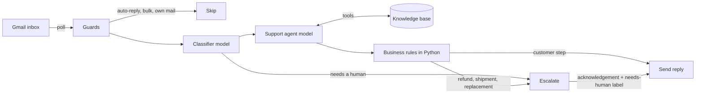

#  AI Customer Support Email Agent: Gmail Auto-Reply with Pydantic AI, FastAPI and RAG Knowledge Base

An AI email agent that answers customer support emails from a Gmail inbox. It runs on a
knowledge base, and when it's unsure it hands the email to a person.

It's built for **Harbor & Pine**, an example home and outdoor store that sells inflatable paddle
boards and flat-pack shelving on Amazon. The agent reads each new email, classifies it, writes a
reply grounded in the knowledge base, and sends it in the same Gmail thread. Refunds, angry
customers, attachments, safety issues and anything the knowledge base doesn't cover go to a
colleague instead.

A small React dashboard shows every processed email and ticket, and lets you edit the
knowledge base without redeploying.

## How it works



1. **Poll.** `app/poller.py` fetches inbox messages that don't have the `ai-processed` label yet.
2. **Guards.** `app/guards.py` skips mail we sent ourselves, auto-replies (`Auto-Submitted`)
   and bulk or list mail, so the bot never gets into a reply loop.
3. **Classify.** A fast model (`app/ai/classifier.py`) picks the knowledge base section and
   decides whether the email needs a human: anger, refund requests, order status, injuries,
   lawyers, prompt-injection attempts, or off-topic questions.
4. **Answer.** The support agent (`app/ai/agent.py`) uses the `list_sections` and
   `get_section` tools to read the knowledge base and returns a structured `AgentReply`.
   An output validator rejects empty replies and replies that mention AI.
5. **Decide.** `app/ai/decide.py` and `app/ai/rules.py` make the final call in plain Python.
   *The models propose; the code decides.* For example, a leaking board leads to a valve check
   first, then a new board if it was delivered within 30 days or a patch kit after that. Any
   step that commits the business to something (shipping parts, an exchange, a replacement) is
   escalated, along with the proposed action.
6. **Reply or escalate.** The reply goes out in the original thread. Escalated threads get the
   `needs-human` label and a short acknowledgement to the customer. The bot leaves those
   threads alone until a colleague removes the label.

Every step is recorded in Postgres (`events`, `tickets`, `messages`). Processing is
idempotent: a message is claimed once, and failed messages are retried up to 3 times.

## Tech stack

| Part | Tools |
| --- | --- |
| Backend | Python 3.13, FastAPI, [Pydantic AI](https://ai.pydantic.dev), pydantic-settings |
| Models | [Groq](https://groq.com): `gpt-oss-20b` (classifier), `qwen3.8-27b` (agent); both configurable |
| Email | Gmail API (OAuth refresh token, `gmail.modify` scope) |
| Database | Postgres on [Supabase](https://supabase.com), accessed with psycopg 3 |
| Dashboard | React 19, TypeScript, Vite, Tailwind CSS 4, shadcn/ui |
| Evals | pydantic-evals with a golden set of 18 emails |
| Package manager | [uv](https://docs.astral.sh/uv/) |

## Project structure

```
app/
  main.py          FastAPI app: dashboard API (HTTP Basic auth) + serves the built dashboard
  poller.py        Polling loop that processes new emails
  pipeline.py      Handles one email from start to finish
  gmail.py         Gmail API wrapper (list, read, label, reply in thread)
  guards.py        Rules for emails the bot must never answer
  db.py            Postgres queries
  config.py        Settings loaded from .env
  ai/
    classifier.py  Triage model
    agent.py       Support agent with knowledge base tools
    rules.py       Business rules for product issues
    decide.py      Combines models + rules into a final Decision
    schemas.py     Pydantic models for structured output
dashboard/         React dashboard (Events, Tickets, Knowledge base)
knowledge_base/    Source Markdown for the knowledge base, one file per section
supabase/          Database migration
scripts/           Gmail OAuth helper, Gmail smoke test, knowledge base seeder
evals/             Golden emails and eval runner
playground/        Run the AI pipeline on one email without sending anything
```

## Setup

### Prerequisites

- Python 3.13 and [uv](https://docs.astral.sh/uv/)
- Node.js 20+ (for the dashboard)
- A Postgres database (a free Supabase project works)
- A Google Cloud project with the Gmail API enabled
- A [Groq API key](https://console.groq.com/keys)

### 1. Install

```bash
git clone https://github.com/seotanvirbd/ai-customer-support.git
cd ai-customer-support
uv sync
cp .env.example .env
```

### 2. Gmail access

1. In Google Cloud Console, enable the **Gmail API** and create an **OAuth client ID** of type
   *Desktop app*.
2. Download the client file and save it as `credentials.json` in the project root.
   It's in `.gitignore`, so it won't be committed.
3. Get a refresh token. This opens a browser window where you sign in with the support inbox:

   ```bash
   uv run python scripts/get_refresh_token.py
   ```

4. Copy the three printed values into `.env`.

### 3. Database

Run the migration in `supabase/migrations/` with the Supabase CLI (`supabase db push`) or
paste it into the SQL editor. Then set `DATABASE_URL` in `.env` and load the knowledge base:

```bash
uv run python -m scripts.seed_knowledge_base
```

Run the seeder again after you edit files in `knowledge_base/`. It updates existing entries.

### 4. Environment variables

| Variable | Description |
| --- | --- |
| `GOOGLE_CLIENT_ID`, `GOOGLE_CLIENT_SECRET`, `GOOGLE_REFRESH_TOKEN` | Gmail OAuth (step 2) |
| `DATABASE_URL` | Postgres connection string |
| `GROQ_API_KEY` | Groq API key |
| `CLASSIFIER_MODEL`, `AGENT_MODEL` | Any Pydantic AI model string, e.g. `groq:openai/gpt-oss-20b` |
| `POLL_INTERVAL_SECONDS` | How often to check the inbox |
| `DASHBOARD_USERNAME`, `DASHBOARD_PASSWORD` | Dashboard login. The dashboard stays locked while the password is empty. |

## Running

**The email agent:**

```bash
uv run python -m app.poller
```

**The API and dashboard:**

```bash
cd dashboard && npm install && npm run build && cd ..
uv run fastapi run app/main.py
```

Open http://localhost:8000 and log in with your dashboard credentials. The dashboard has
three tabs:

- **Events**: every email the bot picked up, with its status (processed, skipped, failed) and the AI decision
- **Tickets**: one ticket per Gmail thread, with category, status and the full conversation
- **Knowledge base**: view and edit entries; the agent uses changes on the next email

For dashboard development with hot reload, run `uv run fastapi dev app/main.py` and, in a
second terminal, `cd dashboard && npm run dev`. Vite proxies `/api` to port 8000.

### API

All `/api` routes need HTTP Basic auth.

| Method | Route | Description |
| --- | --- | --- |
| GET | `/health` | Health check (no auth) |
| GET | `/api/events` | Latest 100 processing events |
| GET | `/api/tickets` | Latest 100 tickets |
| GET | `/api/tickets/{id}/messages` | Messages in a ticket |
| GET | `/api/knowledge-base` | All knowledge base entries |
| PUT | `/api/knowledge-base/{id}` | Update an entry's title and content |
| POST | `/api/poll` | Check the inbox once, now |

## Testing

**Try one email without sending anything.** Edit the question at the top of
`playground/run_pipeline.py`, then run it. It prints the classification, the agent's reply,
the business-rule step and the final decision:

```bash
uv run python playground/run_pipeline.py
```

It also runs cell by cell in VS Code / Jupyter Interactive.

**Run the evals.** 18 golden emails check that each one is routed to the right section and gets
the right action (reply or escalate). They cover board sizing, a German-language email, missing
parts, leaks, refunds and more:

```bash
uv run python -m evals.run_evals
```

The runner waits and retries on rate limits, so it works on Groq's free tier.

**Gmail smoke test.** `scripts/gmail_check.py` connects, reads the newest unprocessed email
and **sends a real reply**. Only use it on a test inbox.

## Safety

- The bot never promises refunds, shipments, replacements, dates or calls. The agent flags
  promises, and the code escalates them.
- Business decisions live in `app/ai/rules.py`, not in a prompt, so they are predictable and
  testable.
- Emails with attachments, prompt-injection attempts and anything outside the knowledge base go
  to a human.
- A colleague takes over a thread by keeping the `needs-human` label on it.
- Secrets live only in `.env` and `credentials.json`, which are both git-ignored.
